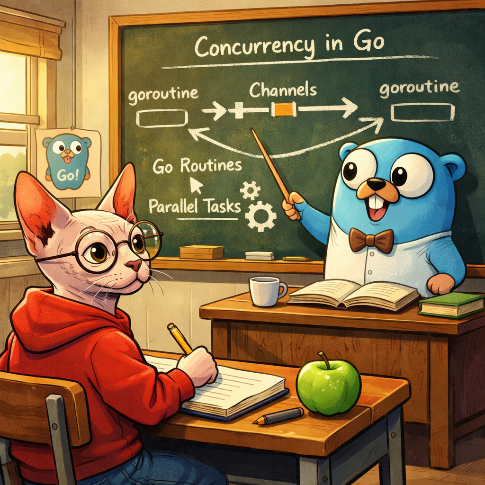

# Go Concurrency Lab



A collection of hands-on Go exercises for learning and practicing concurrency patterns. Directories contain standalone programs, groups of examples, or self-contained mini-projects. These are learning exercises; some deliberately demonstrate pitfalls.

## Exercises

| Name | Link | Overview |
|------|------|---------|
| Atomic | [atomic/](atomic/) | Atomic integer operations and immutable configuration snapshots published with `atomic.Value` |
| Debounce / throttle | [debounce/](debounce/) | Token-gated event processing that drops events while a token is unavailable; this demonstrates throttling rather than trailing-edge debouncing |
| Errgroup | [errgroup/](errgroup/) | Using `golang.org/x/sync/errgroup` to run goroutines, propagate errors, and cancel via context |
| Fan-out / Fan-in | [fan-out-in/](fan-out-in/) | Worker pool pattern distributing jobs across goroutines and collecting results |
| Map + Mutex | [map-mutex/](map-mutex/) | Protecting a shared map with a `sync.Mutex` to prevent concurrent write races |
| Overkill | [overkill/](overkill/) | A concurrent worker-pool FizzBuzz storing results in a `sync.Map` |
| Range (close) | [range/range-close/](range/range-close/) | Demonstrates why closing a channel is required to cleanly `range` over it |
| Range (wait) | [range/range-wait/](range/range-wait/) | Ranging over a buffered channel populated by a goroutine |
| Select (basics) | [select/example/](select/example/) | Non-blocking channel operations using `select` with a `default` case |
| Select (multiread) | [select/multiread/](select/multiread/) | Multiplexing reads from multiple channels with a timeout fallback |
| Singleton | [singleton/](singleton/) | Lazy initialization shared across goroutines using `sync.Once`; press Enter to exit |
| Unbuffered channels | [unbuffered/](unbuffered/) | Eight examples covering synchronization, request-response workers, timeouts, cancellation, daemon shutdown, state ownership, pipeline backpressure, and first-success races |
| WaitGroup | [waitforit/](waitforit/) | Basic `sync.WaitGroup` usage to wait for a pool of goroutines to finish |
| Project: Bucket | [project-bucket/](project-bucket/) | Self-contained project implementing a token-bucket rate limiter |
| Project: Bucket + Workers | [project-bucket-worker/](project-bucket-worker/) | Token-bucket rate limiter driving a pool of concurrent workers |
| Project: Crawler | [project-crawler/](project-crawler/) | Concurrent fetcher for supplied URLs, with workers, retries, a shared token bucket, and Prometheus metrics; it does not discover links |
| Project: Debouncer | [project-debouncer/](project-debouncer/) | Trailing-edge debouncing with timer resets, latest-value delivery, close-time flushing, and cancellation |
| Project: File Indexer | [project-file-indexer/](project-file-indexer/) | Bounded file-hashing pipeline with SHA-256 duplicate detection, backpressure, and cancellation |
| Project: Job Runner | [project-job-runner/](project-job-runner/) | Bounded job queue with worker limits, per-attempt deadlines, retries, and cooperative shutdown |

## Running an Exercise

Use Go 1.24 or newer to run all examples (the bucket projects declare Go 1.22). There is no root `go.mod` or `go.work`; run each module separately, and run examples without a module by naming their Go file.

From the repository root, for example:

```bash
go run fan-out-in/fan.go
go run debounce/debounce1/debounce1.go
go run unbuffered/simple/main.go
```

The following paths are relative to the repository root:

| Directory to enter | Command inside that directory |
|--------------------|-------------------------------|
| `atomic` | `go run ./cmd/atomic-simple`, `go run ./cmd/atomic-demo`, `go run ./cmd/atomic-demo2`, or `go run ./value` |
| `errgroup` | `go run ./cmd/eg-demo` |
| `map-mutex` | `go run ./cmd/main` |
| `project-bucket` | `go run ./cmd/bucket-demo` |
| `project-bucket-worker` | `go run ./cmd/bucket-demo` |
| `project-crawler` | `go run ./cmd/crawler` (provide URLs as shown below) |
| `project-debouncer` | `go run ./cmd/debounce-demo` |
| `project-file-indexer` | `go run ./cmd/indexer -root . -workers 4` |
| `project-job-runner` | `go run ./cmd/runner-demo -timeout 2s` |

Go downloads external dependencies on the first run where needed. Both bucket projects implement their own channel-based token bucket.

The debouncer, file indexer, and job runner use only the standard library and include
tests. Run `go test ./...` inside each project. Each project README explains its
concurrency design and shutdown behavior. The job runner's default demo deliberately
includes a deadline failure; the command above gives that job time to succeed.

For the crawler, pipe the included URL list from inside `project-crawler`:

```powershell
Get-Content sites.txt | go run ./cmd/crawler
```

```bash
go run ./cmd/crawler < sites.txt
```

It also accepts comma-separated URLs in the `URLS` environment variable. Metrics are served at `http://localhost:2112/metrics` while the program runs. See the [crawler README](project-crawler/readme.md) for flags and more examples.

For the other programs without a module, use `go run <path-to-file.go>` from the repository root, or enter the directory containing the file and run `go run <filename.go>`. Some nested READMEs still show `go run .`; use the commands above for the current layout.
