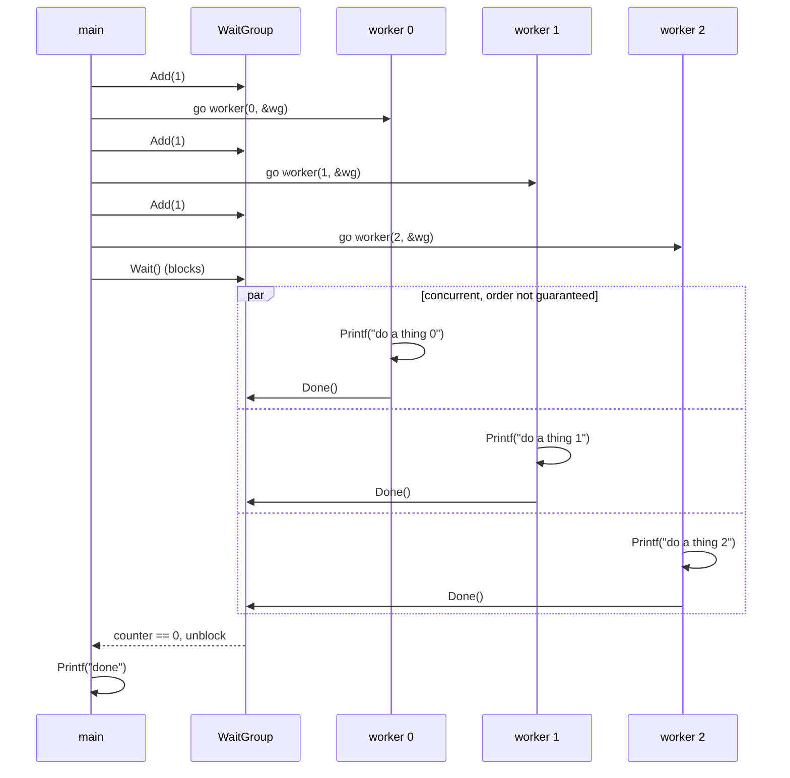

# Waiting for goroutines

Three workers print a message, then main prints `done`. A `sync.WaitGroup` keeps main from returning before the workers finish.

Call `wg.Add(1)` before starting each worker. Each worker calls `defer wg.Done()`, and main calls `wg.Wait()` to block until the counter reaches zero.

Pass the WaitGroup by pointer when sharing it with a function. Copying it gives the worker a different counter.

Run from this directory:

```bash
go run wait.go


```


## Diagram

